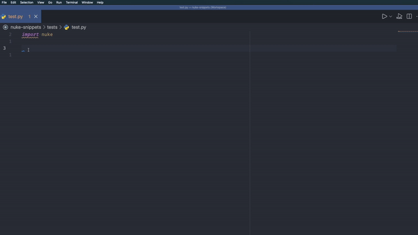

# Nuke python stubs

Type stubs for the Nuke and Hiero Python API, so your editor can autocomplete `nuke`, `nukescripts`, `nuke_internal`, `ocionuke` and `hiero`. The `.pyi` files come with signatures, types and the original docstrings.



Nuke's docstrings rarely say what a function takes or returns, so most of the types here come from running the functions inside Nuke and looking at what comes back.

## Use the stubs

Install `nuke-stubs` from PyPI in the same environment your editor or type checker uses. Without a version, pip gives you the stubs for the newest Nuke (right now Nuke 17.1):

```bash
pip install nuke-stubs
```

If you are on an older Nuke, pin the version:

```bash
pip install "nuke-stubs==15.2.*"
```

The package version is the Nuke version plus a stub revision, so `15.2.9.0` means Nuke 15.2v9, revision 0. With `==15.2.*` you get the newest stubs for Nuke 15.2. If there are no stubs for your exact version, the closest one is fine: `"nuke-stubs>=15,<16"` gets you the newest stubs for Nuke 15.

A couple of things to keep in mind:

- The stubs for Nuke 17 need Python 3.11 or later. On Python 3.10, `pip install nuke-stubs` falls back to the stubs for Nuke 15.2.
- One environment can hold the stubs of only one Nuke version.
- Don't install `types-nuke` next to it, since both packages write the same `nuke-stubs` folder.

If you use Visual Studio Code, you can also install [NukeTools](https://marketplace.visualstudio.com/items?itemName=virgilsisoe.nuke-tools) and run `Nuke Tools: Add Python Stubs`.

If you'd rather not use pip, download the zip for your Nuke version (or the closest one) from [Releases](https://github.com/sisoe24/nuke-python-stubs/releases), unzip it somewhere and point your editor at the folder. For VS Code with Pylance, that's `.vscode/settings.json`:

```json
{
    "python.analysis.extraPaths": ["/path/to/nuke-python-stubs-15.2v9"]
}
```

> [!NOTE]
> I only tested the stubs on macOS.

## Where the types come from

Nuke doesn't ship any type information, so each type comes from one of these places:

- The docstring, when it actually names a type.
- A call inside Nuke. The return type is whatever the function returned in a test scene. For the parameters, the generator does something a bit cheeky: it calls the function with an argument that can't be valid and reads the error message, which usually names the type it wanted.
- Pyright, for `hiero`, `nukescripts`, `nuke_internal` and `ocionuke`, since those are plain Python code.
- The override files, for the types that are still wrong after all of that.

The type `Any` means the generator couldn't find the type, not that any type is valid. Some common cases:

- Knob values, like `node['size'].value()`, are always `Any`.
- Qt types are `Any` on Nuke 15, because PySide2 has no type information. On Nuke 17 they are proper PySide6 types.
- Parameters are `Any` more often than return types, especially in `hiero` and the Python modules.

> [!IMPORTANT]
> Some types are still wrong: see [Fix a wrong type](#fix-a-wrong-type).

## Build the stubs yourself

The generator lives in `src/hoststubs/` and needs [`uv`](https://docs.astral.sh/uv/). You need Nuke (and a licence) only if you want to dump a new Nuke version. Rebuilding from the data in the repository works offline:

```bash
uv run python -m hoststubs build data/nuke/15.2v9/dump.json
```

This writes the stubs in `build/nuke-15.2v9/` and then checks them: every file must parse, every name must resolve, and the type-check corpus in `tests/corpus` must match its snapshot. It also writes `build/nuke-python-stubs-15.2v9.zip`, which is the file that goes on the release.

To add a new Nuke version, follow [docs/new-version.md](docs/new-version.md).

## Fix a wrong type

Add a line to the override file of the module, for example `src/hoststubs/hosts/nuke/overrides/nuke.pyi`. It is a normal stub line:

```python
def toNode(s: str) -> Node | None: ...
```

The format is described at the top of `src/hoststubs/overrides.py`. If the build can't resolve a type you wrote, it fails, so you'll know right away. Then run `uv run pytest -q` and build again.

## Older versions

Releases up to [v0.3.1](https://github.com/sisoe24/nuke-python-stubs/releases/tag/v0.3.1) are the `.py` stubs from the old docstring-guessing script. If the new stubs give you trouble, those are still there. Everything is on the [Releases](https://github.com/sisoe24/nuke-python-stubs/releases) page.

## Acknowledgment

The PyCharm stub generator inspired this project.
